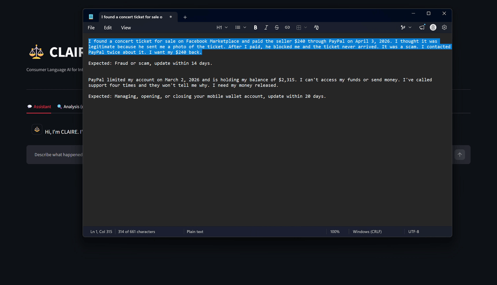

# Showrish Reddy Sampath

### Data Analytics · Applied AI · Operations

**I turn messy operational data into reliable dashboards, automated workflows, and practical AI tools.**

MPS in Applied Machine Intelligence, **Northeastern University** · **3.96/4.0 GPA**  
Boston, MA

[Explore my work](#featured-work) · [Browse by skill](#more-applied-work) · [LinkedIn](https://linkedin.com/in/showrish-reddy-sampath-b508a22a6) · [Email me](mailto:sampath.sho@northeastern.edu)

---

I build tools for the point where data meets day-to-day operations: reconciling inconsistent records, investigating surprising numbers, and turning repetitive analysis into repeatable workflows. My work spans pharmaceutical monitoring, mortgage analytics, and consumer-complaint triage.

**I would rather find out why a number looks wrong than publish it.**

## Featured work

| Focus | Evidence to explore |
| :--- | :--- |
| **Reliable data pipelines** | ShortageSignal: **16 data checks** before saving |
| **Large-scale analysis** | CreditIQ: **8.68M mortgage applications**, SQL, and explainable ML |
| **Applied AI evaluation** | CLAIRE: a **45% baseline to 80%+** team-reported result |

### [ShortageSignal](https://github.com/Showrish/shortagesignal)

**Daily drug recall monitoring with AI-assisted analysis**

Connects public FDA recall and shortage data so a reviewer can see what changed and what needs a closer look.

- **16 data checks** run before saving. Critical failures preserve the last successful dataset.
- SQL rules classify root causes first, with Claude handling unresolved cases across **12 allowed labels**. Uncertain outputs go to review queues.
- A **Streamlit dashboard**, weekly digests, and Excel review lists make the pipeline's results usable.
- **Ask the data** answers natural-language questions through restricted, read-only SQL and shows the query behind each answer.

`Python` `SQL` `DuckDB` `Claude API` `Streamlit` `Power BI` `GitHub Actions`

**[Open dashboard ↗](https://shortagesignal.streamlit.app)** · [Code](https://github.com/Showrish/shortagesignal) · [Evaluation and limitations](https://github.com/Showrish/shortagesignal/blob/main/docs/limitations.md)

The dashboard may take a moment to wake. The Ask the data tab is passcode-protected.

---

### [CreditIQ](https://github.com/Showrish/Credit-Risk-Scoring)

**8.68 million mortgage applications, from SQL analysis to explainable ML**

A personal research project exploring historical approval decisions and demographic disparities in public HMDA data.

- Prepared **12.2M raw records into 8.68M analysis-ready rows** using SQL and DuckDB.
- Achieved **0.877 ROC-AUC** with LightGBM on the project's held-out test split.
- Found a **15.1 percentage-point gap** in raw denial rates between Black and White applicants. This is an unadjusted comparison.
- Presented findings through **Power BI**, explained model behavior with **SHAP**, and built a **FastAPI** prediction interface.

  

`SQL` `DuckDB` `LightGBM` `SHAP` `Power BI` `FastAPI`

[Explore the project →](https://github.com/Showrish/Credit-Risk-Scoring) · [Model comparison](https://github.com/Showrish/Credit-Risk-Scoring#model-comparison)

---

### [CLAIRE](https://github.com/Showrish/CLAIRE)

**Consumer complaint triage with an evaluation workflow** · Four-person course project

A prompt-based Streamlit application that classifies complaints, assigns resolution timelines, and drafts acknowledgment messages using GPT-4o-mini.

- **My contribution:** built the **Streamlit application and Evaluate tab**, including the interface for testing labeled complaint data.
- The team's final **v4a + RAG** evaluation reported product classification improving from a **45% zero-shot baseline to 80%+**.
- Error analysis identified overlapping complaint labels as a limitation of the public dataset.

<strong>Watch the complaint-triage demo</strong>

  

`OpenAI API` `Prompt evaluation` `Streamlit`

[Explore the project →](https://github.com/Showrish/CLAIRE) · [Evaluation results](https://github.com/Showrish/CLAIRE#prompting-strategy-results)

## More applied work

| Project | What it demonstrates |
| :--- | :--- |
| **[Batch Monitor](https://github.com/Showrish/snowflake-batch-monitor)** | **Snowflake and manufacturing analytics.** A pipeline and Streamlit app for **1,005 public pharmaceutical batches**, with I-MR charts, material genealogy, and independent pandas checks. Code and screenshots document the app built during a Snowflake trial. |
| **[Request Handoff Check](https://github.com/Showrish/request-handoff-check)** | **Excel and process analysis.** Reconciles hiring requests across two systems, finds missing records, and identifies a **7.4-day Finance approval bottleneck**. Built on synthetic data with XLOOKUP, COUNTIFS, and PivotTables. |
| **[WeatherCastML](https://github.com/Showrish/Weather-Forecast)** | **Data processing and forecasting.** A solo project processing **92M NOAA records** with DuckDB and building three LightGBM models for temperature, rain, and extreme weather, with a FastAPI interface. |
| **[Smart Water Quality](https://github.com/Showrish/Smart-Water-Quality-Prediction-using-IoT-and-ML-)** | **IoT and operational monitoring.** An undergraduate sensor and ML project, later extended with a Streamlit dashboard that flags stale data and implausible readings. |

## Technical toolkit

| Area | Tools I use |
| :--- | :--- |
| **Analysis and reconciliation** | Python · SQL · pandas · NumPy · Excel (XLOOKUP, PivotTables, reconciliation) |
| **Dashboards and applications** | Power BI (DAX, Power Query) · Tableau · Streamlit · FastAPI |
| **Databases and cloud** | DuckDB · Snowflake · PostgreSQL · AWS EC2, S3, Glue |
| **Machine learning and AI** | scikit-learn · LightGBM · XGBoost · SHAP · OpenAI API · Claude API · RAG · FAISS |
| **Testing and automation** | Git · GitHub Actions · pytest · ruff |

## How I approach a project

- **Check the data first.** I investigate missing records, mismatched IDs, and surprising totals before interpreting results.
- **Evaluate AI against examples.** I use explicit labels, inspect errors, and surface uncertain cases for review.
- **Make the output usable.** I build dashboards, review lists, and documentation that help someone take the next step.

## Connect

**[sampath.sho@northeastern.edu](mailto:sampath.sho@northeastern.edu)** · **[LinkedIn](https://linkedin.com/in/showrish-reddy-sampath-b508a22a6)**
