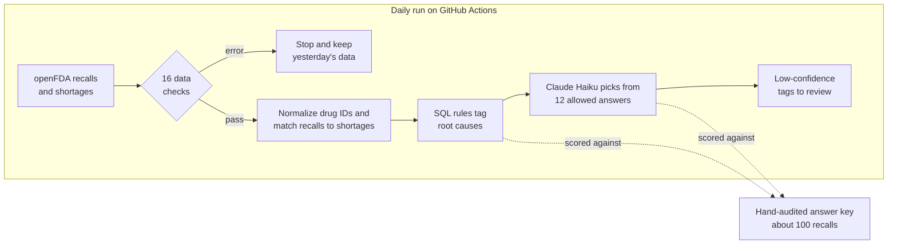
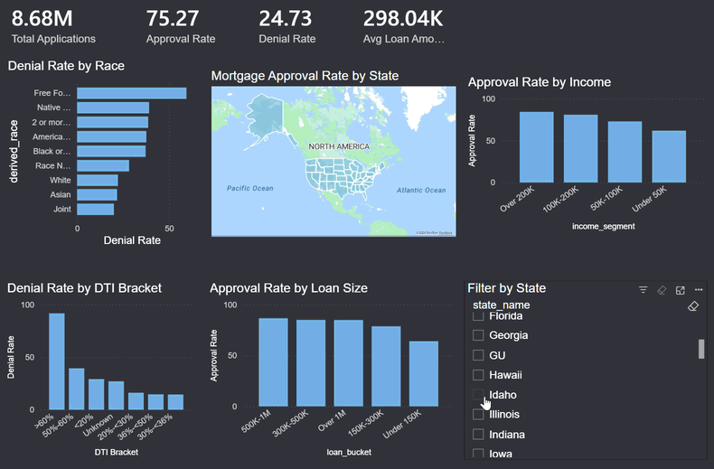
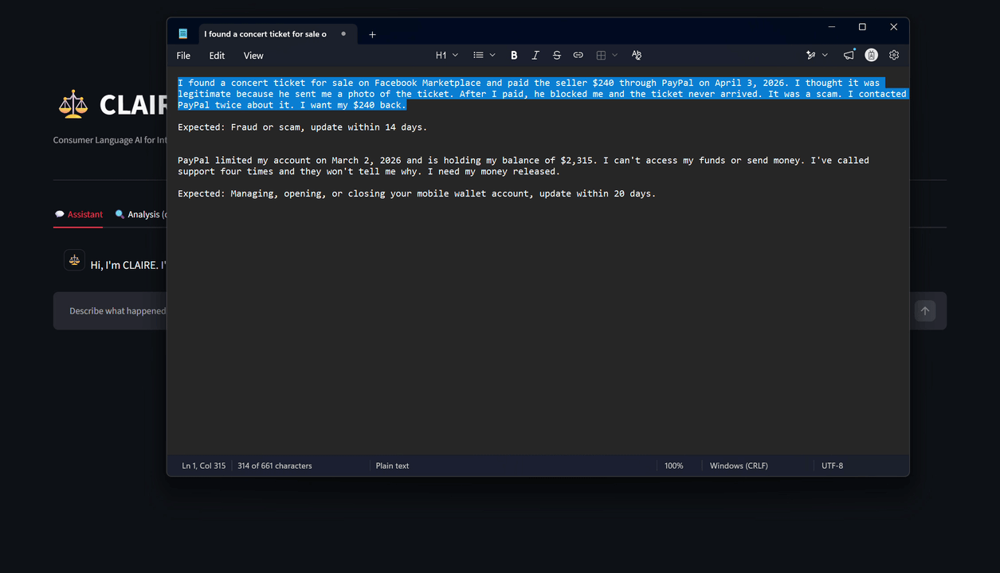

# Showrish Reddy Sampath

### Turning messy data into decisions people can trust.

**Data Analytics · Applied AI · Operations**

MPS in Applied Machine Intelligence, **Northeastern University** · **3.96 GPA**  
Boston, MA

[Explore my projects](#featured-projects) · [LinkedIn](https://linkedin.com/in/showrish-reddy-sampath-b508a22a6) · [Email me](mailto:sampath.sho@northeastern.edu)

---

I work at the messy end of data: reconciling systems that disagree, building dashboards people can trust, and using AI to automate repetitive work. My projects connect **data quality, analytics, and practical applications**, with a focus on making the results useful to the people making decisions.

**I would rather find out why a number looks wrong than publish it.**

## Featured projects

### [ShortageSignal](https://github.com/Showrish/shortagesignal)
**Connecting drug recalls to shortage signals** · In progress

An automated daily pipeline linking FDA drug recalls to shortages, with data checks and evaluated AI tagging built into the workflow.

- Runs **16 data checks** on every pipeline execution.
- Tags root causes with **SQL rules first**, then **Claude Haiku** limited to **12 allowed answers**.
- Scores both against **~100 hand-audited recalls** and routes low-confidence tags to review.
- Includes continuous integration with **ruff and pytest**.

`Data pipelines` `Data quality` `SQL` `Claude Haiku` `GitHub Actions`

[Explore the repository →](https://github.com/Showrish/shortagesignal)

---

### [CreditIQ](https://github.com/Showrish/Credit-Risk-Scoring)
**Mortgage approval prediction with a fairness audit**

A national HMDA data project spanning SQL preparation, predictive modeling, explainability, and a dashboard and API.

  

- Cleaned **12.2M raw records to 8.68M** using SQL in DuckDB.
- Built a **LightGBM model with 0.877 ROC-AUC**.
- Found a **15-point denial gap** between Black and White applicants (37.3% vs 22.2%) using SQL.
- Explained the model with **SHAP**, where race ranked 5th among its drivers.
- Presented results through **Power BI** and **FastAPI**.

`SQL` `DuckDB` `LightGBM` `SHAP` `Power BI` `FastAPI`

[Explore the repository →](https://github.com/Showrish/Credit-Risk-Scoring)

---

### [CLAIRE](https://github.com/Showrish/CLAIRE)
**LLM complaint triage with measurable evaluation** · Team of 4

A complaint triage tool combining retrieval-augmented generation with systematic prompt evaluation.

  

- The team raised accuracy from **45% to over 80%** across **5 prompting strategies**.
- Traced the **~80% ceiling** to inconsistent labels in the public CFPB data, not the model.
- Used retrieval-augmented generation over a **FAISS index**.
- **My contribution:** built the **Streamlit application and its Evaluate tab**, making evaluation accessible through the interface.

`LLMs` `RAG` `FAISS` `Prompt engineering` `Streamlit`

[Explore the repository →](https://github.com/Showrish/CLAIRE)

## More ways I work with data

| Project | Problem and evidence | Tools / approach |
| :--- | :--- | :--- |
| **[Batch Monitor](https://github.com/Showrish/snowflake-batch-monitor)** | Monitors data quality across **1,005 public pharmaceutical batches**. Includes an I-MR control chart and lot genealogy, with Power BI figures reconciled against SQL and pandas. | Snowflake · Streamlit in Snowflake · Power BI · SQL · pandas |
| **[WeatherCastML](https://github.com/Showrish/Weather-Forecast)** | Weather forecasting app with **3 LightGBM models** built on **92M NOAA records**. Next-day temperature achieved **R² 0.967**, with errors of **3.7°F and 4.6°F in two live Boston tests**. | LightGBM · DuckDB · FastAPI · Forecasting · Web application |
| **[Request Handoff Check](https://github.com/Showrish/request-handoff-check)** | Reconciles two hiring systems using **synthetic data**. Identified a **7.4-day Finance approval bottleneck** and caught hidden spaces, a mistyped ID, and a duplicate. | Excel · XLOOKUP · COUNTIFS · PivotTables · Reconciliation · Process analytics |
| **[Smart Water Quality](https://github.com/Showrish/Smart-Water-Quality-Prediction-using-IoT-and-ML-)** | IoT water quality monitoring. The Streamlit rebuild of its dashboard checks sensor readings **every 15 seconds** and flags stale data and impossible readings. **[View original dashboard ↗](https://waterquality-1dcdc.web.app/)** | IoT · Sensor validation · Monitoring · Streamlit · Firebase |

## How I use AI

| AI? | Task | My approach |
| :---: | :--- | :--- |
| ✅ | Classifying and tagging messy text | OpenAI and Claude APIs called from Python, with fixed label sets and structured outputs |
| ✅ | Automating repetitive work | Scheduled pipelines with data checks on every run |
| ✅ | Writing and debugging code faster | Claude, Claude Code and ChatGPT, and I run and check everything before it ships |
| ✅ | Drafting documentation and reports | READMEs, summaries and first drafts, which I edit and fact-check before they go out |
| ❌ | Replacing rules that already work | Simple, predictable rules come first |
| ❌ | Trusting output I haven't measured | Models get scored against labeled data or an answer key first |
| ❌ | Final calls on unclear cases | Low-confidence results go to a person |

## Technical toolkit

| Area | Tools |
| :--- | :--- |
| **Data and analytics** | Python · pandas · NumPy · SQL · DuckDB · Snowflake · PostgreSQL · Excel |
| **Machine learning** | scikit-learn · LightGBM · XGBoost · SHAP |
| **Applied AI** | OpenAI API · Claude API · RAG · FAISS · Prompt engineering |
| **Dashboards and applications** | Power BI · Tableau · Streamlit · FastAPI |
| **Engineering and cloud** | Git · GitHub Actions · pytest · AWS (EC2, S3, Glue) |

## Let's connect

Interested in **Data Analytics, Applied AI, and Tools that help operations teams make better decisions**? I'd love to connect.

**[LinkedIn](https://linkedin.com/in/showrish-reddy-sampath-b508a22a6)** · **[sampath.sho@northeastern.edu](mailto:sampath.sho@northeastern.edu)**
